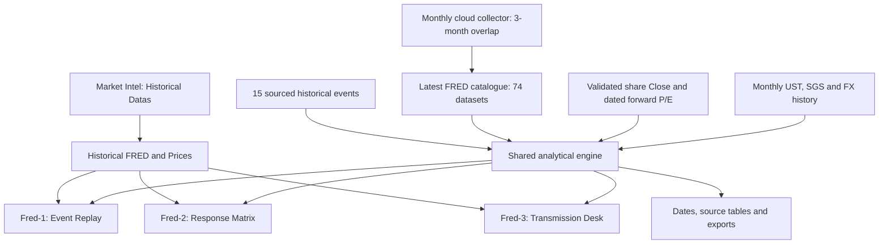

# Historical FRED and Prices — source handoff

The complete Sol 6.1 high-reasoning build prompt is `historical-fred-prices-implementation.md`. It defines the event mappings, layouts, colour tokens, source contracts and acceptance checks. The implementation belongs to the existing `notwins/market-intelligence-hub` repository and consumes its public historical datasets; it is not a separate data service.

## Page structure

## Source package

The package contains the new HTML, shared CSS/JavaScript, event registry, analytical tests, this handoff and the full prompt. The repository patch carries navigation integration. Existing dependency files remain authoritative in the repository: `fred/data-client.js`, `share-lab-data.js`, `company-logos.js`, `company-logos.css`, local company-logo assets, and public history/FRED datasets. Avoid copying an old data catalogue from a handoff package over current main.

Start future work from current main, read `AGENTS.md`, then apply only the intended source changes. Preserve all immutable data snapshots and the independent research-content reader. The normal Pages build adds the shared footer, projects approved public data, and validates the exact deployment artifact. Source previews may lack that generated footer until the artifact build.

The additional local event-coverage CSV contains 15 events × 74 datasets. Its coverage classification compares archive bounds with a ±12-month window; it does not establish complete observations, publication-date availability or causal relationships.

## Monthly data ownership

`fred-observatory-monthly.yml` collects official-source observations on the first day of each month at 08:00 Asia/Singapore. It fetches a recent three-month overlap, upserts source identities with current explicit values, retains older observations and records revisions in a new immutable snapshot. GitHub scheduling can start later than the nominal time.

The separate local mirror automation runs at 09:00 Singapore and verifies the published archive before copying it to the owner's raw-data folder. It does not fetch the sources again. The historical dashboards read the current catalogue and therefore inherit a verified monthly update without a separate UI release.

## Interpretation

These screens are retrospective comparisons of the latest stored vintages. They do not recreate real-time information sets. Price changes retain local quotation currency and source adjustment conventions; they are not total returns. P/E is dated consensus-forward valuation, not reported historical earnings. An event marker identifies timing, not causation. Missing history is unavailable. The 1σ/2σ scale identifies distance from a pre-event reference distribution, not a trading recommendation.
